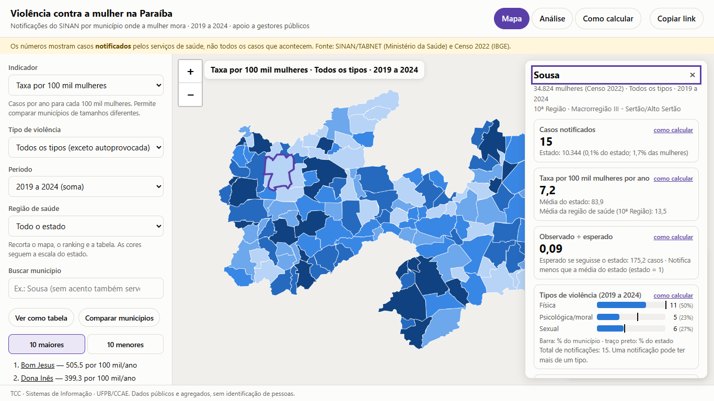
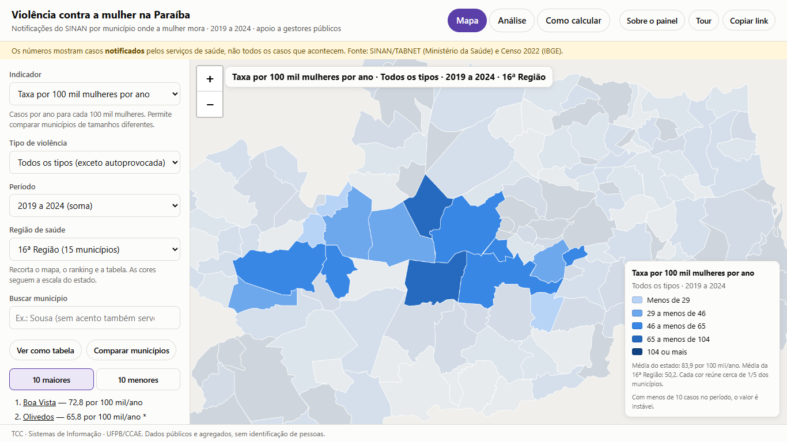
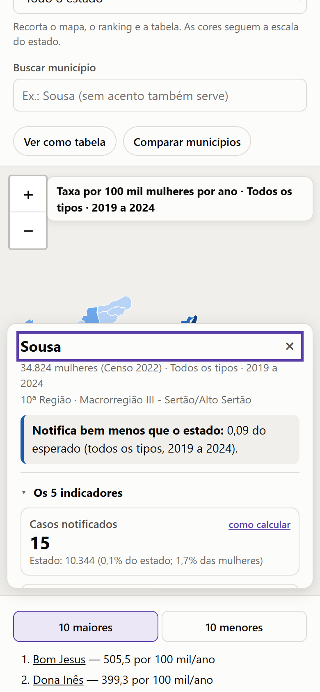
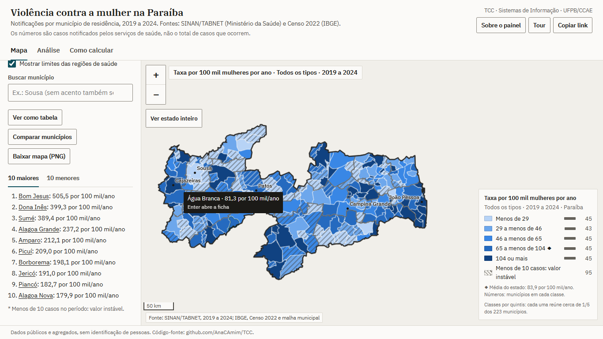
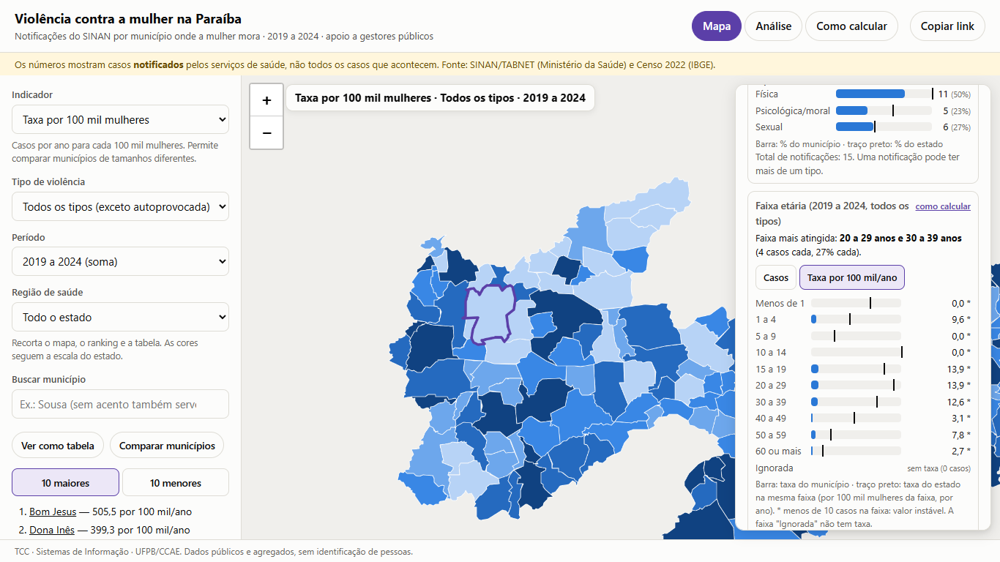
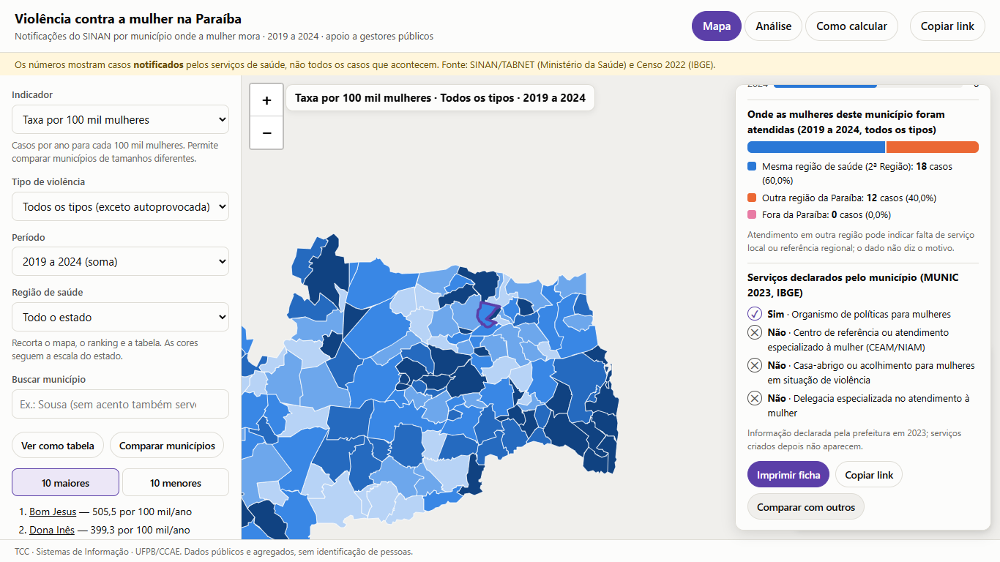
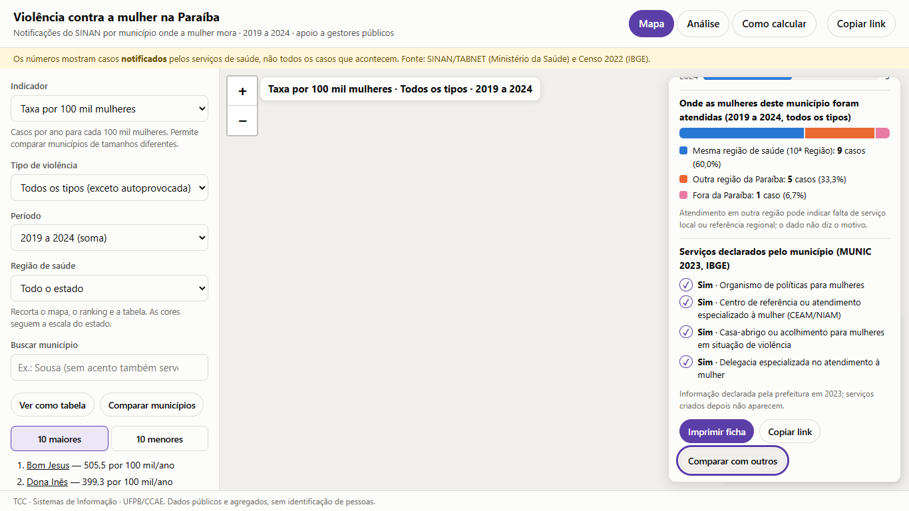
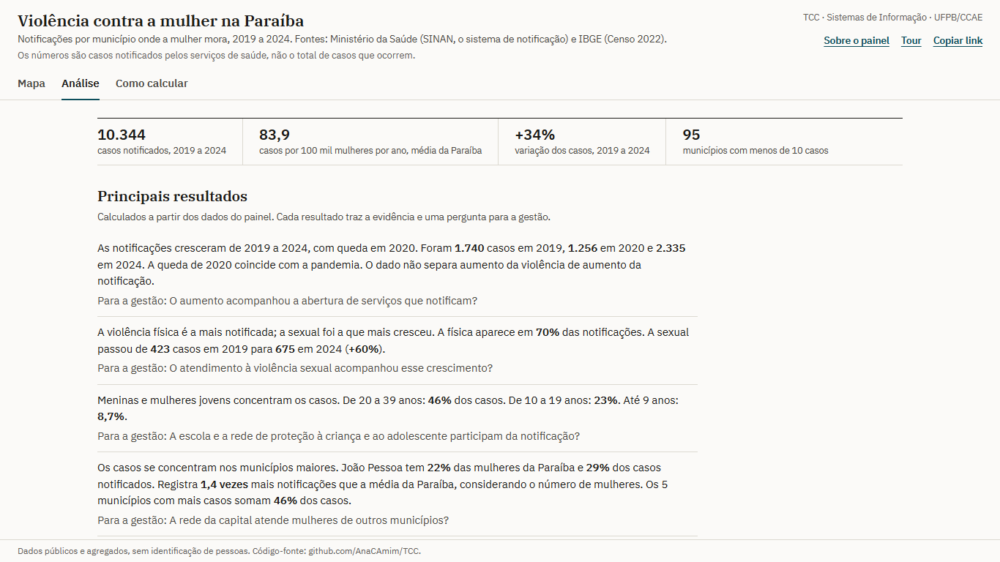
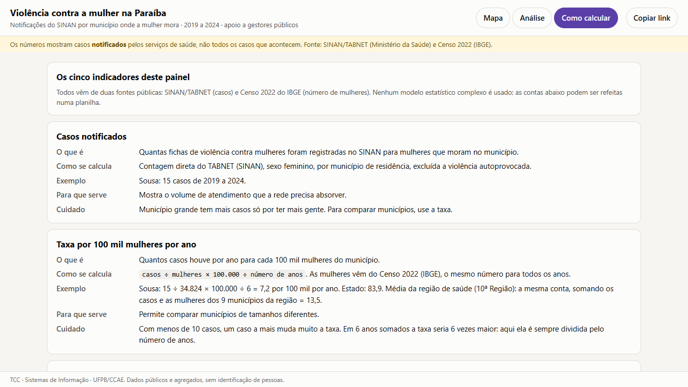
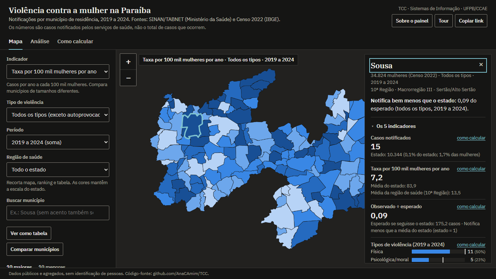

# Painel de indicadores de violência contra a mulher na Paraíba (SINAN, 2019–2024)

Painel web para **gestores públicos** acompanharem as notificações de violência contra a mulher nos 223 municípios da Paraíba. Mostra **5 indicadores**: casos notificados, taxa por 100 mil mulheres por ano, tipos de violência, faixa etária e observado ÷ esperado. Todos os números saem de dados públicos e agregados (nenhuma pessoa é identificada) e podem ser refeitos numa planilha.

Trabalho de Conclusão de Curso (artigo tecnológico), Sistemas de Informação, UFPB, Campus IV.



## Como abrir o painel

- **Sem instalar nada:** dê duplo clique em `web/index.html`. Funciona offline, no Chrome, Edge, Firefox ou Safari (usa `web/dados.js`).
- **Num servidor** (GitHub Pages, servidor da universidade ou `python -m http.server` dentro de `web/`): publique a pasta `web/`. O painel lê `web/dados.json`.

O painel tem três telas: **Mapa** (filtros, mapa, ranking e ficha do município), **Análise** (gráficos, conclusões e tabela para baixar em CSV) e **Como calcular** (cada indicador com fórmula e exemplo).

## Como atualizar os dados (refazer tudo a partir dos dados brutos)

Requisitos: **Windows**, **Docker Desktop** aberto e **Python 3**. Dê duplo clique em `atualizar.bat`. Ele faz, em ordem, e para com mensagem em português se algo falhar:

1. confere os dados brutos (`pipeline/conferir.py`);
2. carrega tudo no PostgreSQL/PostGIS (container `pgtcc`, banco `websig`) numa transação só. Se o total não for **10.344 casos, 223 municípios e 2.055.832 mulheres**, ou se a região de saúde não cobrir os 223 municípios, a carga aborta e o banco anterior fica intacto;
3. cria as views dos indicadores (`sql/03_views_indicadores.sql`);
4. exporta `web/dados.json` e `web/dados.js` e confere de novo os totais e as contas;
5. roda os testes (dados, painel e usabilidade). Na primeira vez cria `.venv/` com o Playwright (usa o Chrome instalado).

`testar_navegadores.bat` repete os testes do painel no Firefox e no WebKit (o motor do Safari).

O banco é só local: a senha do Postgres no `atualizar.bat` serve apenas ao container de desenvolvimento, que aceita conexões só do próprio computador (`127.0.0.1`).

## Fontes dos dados

| Dado | Fonte | Acesso |
|---|---|---|
| Notificações de violência (mulheres, município de residência, 2019–2024, sem violência autoprovocada), por ano, tipo e faixa etária | SINAN/TABNET, Ministério da Saúde | 14/10 e 20/10/2026 |
| Mulheres por município (denominador) e por faixa etária | IBGE, Censo 2022, SIDRA tabela 9514 (API) | 18/11/2026 |
| Local de atendimento (contexto): residência × região de saúde de notificação | SINAN/TABNET, mesma base das notificações | 18/11/2026 |
| Serviços declarados pelo município (contexto da ficha) | IBGE, MUNIC 2023, bloco "Política para Mulheres" e item de delegacia especializada | 18/11/2026 |
| Nomes oficiais dos municípios | IBGE, API de localidades | 18/11/2026 |
| Região e macrorregião de saúde | Ministério da Saúde/DATASUS, Base Territorial (jun/2026) | 18/11/2026 |
| Malha municipal | contornos derivados da malha municipal do IBGE, via [tbrugz/geodata-br](https://github.com/tbrugz/geodata-br), licença CC0 1.0 (domínio público; conferida na página do repositório em 18/11/2026) | 14/10/2026 |

Detalhes, recortes e conferências em [`dados/brutos/FONTES.md`](dados/brutos/FONTES.md).

## Como cada indicador é calculado

As mesmas fórmulas estão nas views SQL e no painel (`web/js/calculo.js`). O teste compara as duas em todas as 6.244 combinações de município × tipo × período.

| Indicador | Cálculo | Exemplo (Sousa, 2019–2024, todos os tipos) |
|---|---|---|
| Casos notificados | contagem do SINAN | 15 casos |
| Taxa por 100 mil mulheres por ano | casos ÷ mulheres × 100.000 ÷ número de anos (6 no acumulado, 1 num ano) | 15 ÷ 34.824 × 100.000 ÷ 6 = 7,2 (estado: 83,9) |
| Tipos de violência | casos de física, psicológica/moral e sexual (uma notificação pode ter mais de um tipo; não somam o total) | — |
| Faixa etária | casos por faixa de idade, 2019–2024; e taxa da faixa = casos da faixa ÷ mulheres da faixa × 100.000 ÷ 6 (a faixa "Ignorada" não tem taxa) | mais atingidas: 20 a 29 e 30 a 39 anos (4 casos cada). Estado, 10 a 14 anos: 1.315 ÷ 138.805 × 100.000 ÷ 6 = 157,9 |
| Observado ÷ esperado | esperado = mulheres do município × (casos do estado ÷ mulheres do estado); O/E = casos ÷ esperado (1 = igual ao estado) | esperado 175,2; 15 ÷ 175,2 = 0,09 |

**Média da região de saúde** (na ficha e na legenda): a mesma taxa, somando os casos e as mulheres dos municípios da região. O observado ÷ esperado continua comparando com o estado.

Exemplo de consulta no banco:
```sql
SELECT nome, casos, round(taxa_100mil_ano, 1) AS taxa, round(o_sobre_e, 2) AS oe
FROM websig.vw_indicador_municipio_ano_tipo
WHERE periodo = '2019-2024' AND tipo = 'total' ORDER BY o_sobre_e LIMIT 10;
```
Views: `vw_indicador_municipio_ano_tipo` (município × período × tipo), `vw_indicador_estado`, `vw_indicador_regiao`, `vw_faixa_municipio` e `vw_faixa_estado` (taxa por faixa etária), `vw_local_atendimento` e `vw_local_estado` (local de atendimento).

## O que o painel oferece

- Filtros de indicador, tipo de violência, período (cada ano ou 2019–2024) e **região de saúde** (16 regiões; recorta o mapa, o ranking e a tabela e aproxima o mapa da região).
- Título do mapa com os filtros ativos; legenda com a média do estado (e da região, quando escolhida).
- Ranking dos 10 maiores e dos 10 menores (nos menores entram só municípios com pelo menos 10 casos).
- **Ficha do município:** os 5 indicadores comparados com o estado e com a região de saúde, série anual, tipos, faixa etária ("Faixa mais atingida" e botões **Casos | Taxa por 100 mil/ano**, com a taxa do estado como referência), aviso de poucos casos, link "como calcular" e **Imprimir ficha**.
- **Onde as mulheres foram atendidas** (contexto, na ficha e na Análise): barra única de 100% com mesma região de saúde, outra região da Paraíba e fora da Paraíba, com número e %. % = casos atendidos na categoria ÷ casos do município × 100. Não é indicador e não diz o motivo.
- **Serviços declarados pelo município (MUNIC 2023, IBGE):** organismo de políticas para mulheres, centro de referência, casa-abrigo e delegacia especializada, com ícone e texto (sim / não / sem dado). É contexto: não entra em nenhuma conta nem no mapa.
- Comparar 2 ou 3 municípios; ver o mapa como tabela; baixar CSV (separador `;`, vírgula decimal, abre direto no Excel ou no Calc).
- Endereço por tela e por município: `#mapa`, `#analise`, `#como-calcular`, `#mapa-<código IBGE>` (ex.: `#mapa-2516201` é Sousa), com o botão **Copiar link**.
- Acessibilidade (WCAG 2.1 AA): contraste conferido nos temas claro e escuro, paleta testada para daltonismo, uso completo pelo teclado (Tab percorre também os municípios do mapa e Enter abre a ficha), etiqueta do município também no toque (1º toque mostra, 2º abre a ficha), funciona no celular. Revisão completa em [`docs/websig_usabilidade.md`](docs/websig_usabilidade.md).

| Região de saúde | Celular | Teclado no mapa |
|---|---|---|
|  |  |  |

| Faixa etária em taxa | Serviços declarados (MUNIC 2023) | Onde foram atendidas |
|---|---|---|
|  |  |  |

| Análise | Como calcular | Tema escuro |
|---|---|---|
|  |  |  |

A ficha impressa (botão **Imprimir ficha**) sai numa folha limpa, com fonte e data; os testes geram um exemplo em PDF em `capturas/` (não publicado).

## Testes

- `testes/testar_dados.py`: totais, somas e coerência do banco, inclusive mulheres por faixa (soma 2.055.832 por município e no estado) e MUNIC igual ao bruto (só biblioteca padrão).
- `testes/testar_front.py`: o painel nos dois modos de abertura (arquivo e servidor); taxa e O/E iguais à view em 6.244 combinações taxa das 16 regiões em 448 e taxa por faixa em 2.230; % do local de atendimento em 669; frase do estado; bloco MUNIC igual ao bruto em 10 municípios sorteados; links, ficha, impressão, comparação, CSV, filtro de região, teclado (inclusive no mapa), toque e telas em 1366, 1920 e 390 px, claro e escuro.
- `testes/testar_usabilidade.py`: refaz as 5 tarefas do teste com usuários a partir da página inicial, conta as ações (todas com 1 ou 2) e confere contraste, daltonismo e celular em 320 px.
- Os dois últimos aceitam `--navegador firefox` ou `--navegador webkit`.

## Documentação e teste com usuários

- [`docs/websig_plano.md`](docs/websig_plano.md): arquitetura, telas e plano de avaliação.
- [`docs/websig_usabilidade.md`](docs/websig_usabilidade.md): revisão pelas heurísticas de Nielsen e pela WCAG 2.1 AA, teste-piloto das tarefas e compatibilidade entre navegadores.
- [`docs/teste_usuarios/`](docs/teste_usuarios/): roteiro de 20 minutos, tarefas com gabarito, questionário SUS (versão brasileira validada), perguntas abertas, termo de consentimento e planilha de registro com a nota SUS calculada por fórmula. O gabarito e a planilha são gerados por `python testes/gerar_material_teste.py` (precisa de `openpyxl`).

## Estrutura

```
dados/brutos/   arquivos originais do TABNET, IBGE e DATASUS, com fontes e datas (FONTES.md)
sql/            01_schema, 02_carga (aborta se os totais não baterem), 03_views_indicadores
pipeline/       conferir.py (dados brutos), exportar.py (gera os dados do painel), banco.py (acesso ao banco),
                extrair_munic2023.py (extrai a PB da planilha da MUNIC; precisa de openpyxl)
web/            o painel: index.html, css/, js/ (util, dados, calculo, mapa, analise, app), vendor/leaflet, dados.json e dados.js
testes/         testes acima, respostas_tarefas.py e gerar_material_teste.py (gabarito e planilha do teste com usuários)
capturas/       telas geradas pelos testes (só as do README vão para o repositório)
docs/           plano do painel, revisão de usabilidade e acessibilidade, material do teste com usuários
atualizar.bat   roda tudo em ordem; testar_navegadores.bat repete os testes no Firefox e no WebKit
```

Tecnologias: PostgreSQL 16 + PostGIS 3.4 (Docker), Python 3 (só biblioteca padrão no pipeline; Playwright nos testes), HTML, CSS e JavaScript sem framework, Leaflet 1.9.4. O JavaScript fica em arquivos comuns (`<script src>`), sem módulos ES, porque o Chrome bloqueia módulos em páginas abertas com duplo clique.

## Limitações

- Mede **notificação**, não ocorrência: um município que notifica pouco pode ter dificuldade de registro, não menos violência.
- O denominador é o mesmo (mulheres no Censo 2022) para todos os anos.
- Os tipos de violência se sobrepõem e não somam o total.
- A taxa por faixa etária usa as mulheres do Censo 2022 para os 6 anos; com menos de 10 casos na faixa, ela é instável (o painel marca com *).
- Os serviços da MUNIC 2023 são declarados pela prefeitura; serviços criados depois de 2023 não aparecem, e "sem dado" não quer dizer que o serviço não existe.
- O SINAN de 2023 e 2024 ainda pode ser revisado.
- Municípios com menos de 10 casos têm valores instáveis (o painel avisa).

## Licença

Código sob licença MIT (ver `LICENSE`). O Leaflet tem licença própria (BSD 2-Clause). Os dados públicos de `dados/brutos/` pertencem às fontes citadas.
