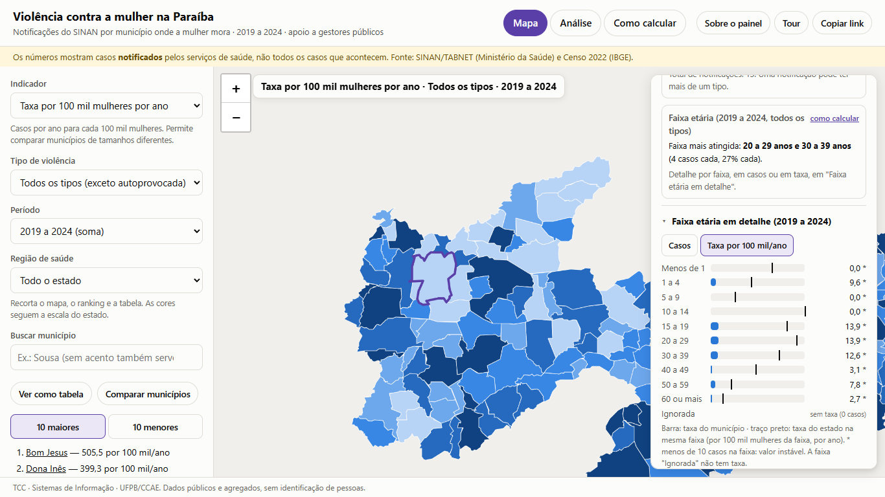
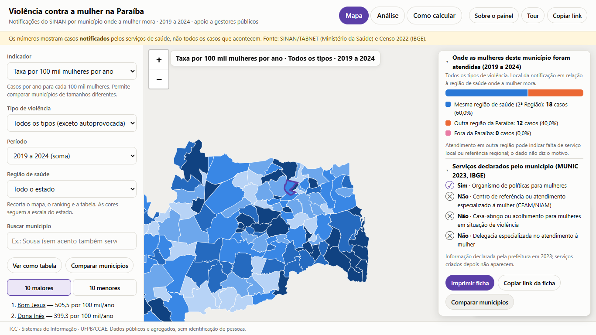
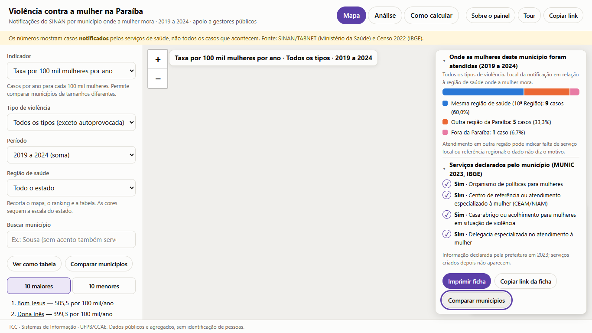
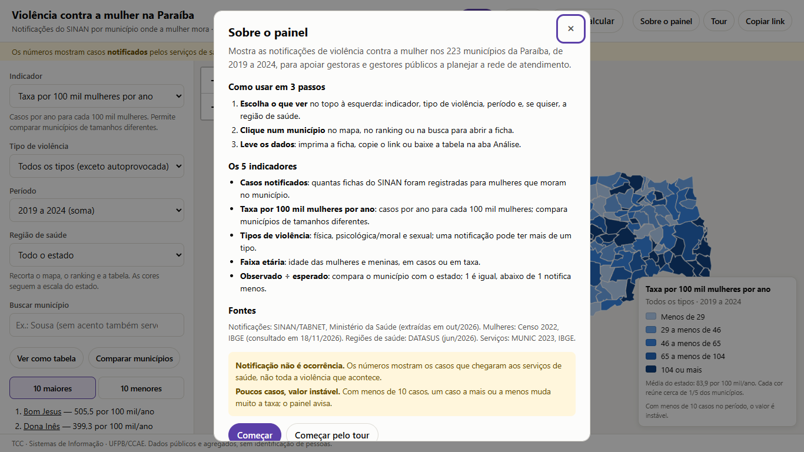

# Ramo `bases-contexto`: o que ele acrescenta ao painel

Proposta para avaliação do orientador (18/11/2026). O ramo está separado da versão principal (`main`) e só entra nela com aprovação. **Nenhum indicador novo**: o painel continua com os 5 (casos, taxa por 100 mil mulheres por ano, tipos, faixa etária, observado ÷ esperado). As três novidades refinam um indicador ou dão contexto, e todas podem ser recalculadas numa planilha.

Link do ramo: https://github.com/AnaCAmim/TCC/tree/bases-contexto

---

## 1. Faixa etária em taxa (refina o indicador 4)

A faixa etária, que antes era só contagem, ganha a opção **"Taxa por 100 mil/ano"**, na ficha e na Análise.

- **Fórmula:** casos da faixa ÷ mulheres da faixa × 100.000 ÷ 6.
- **Fonte do denominador:** Censo 2022 (IBGE, SIDRA 9514), com os grupos de idade somados nas mesmas faixas do SINAN. A carga confere 2.055.832 mulheres em cada município e no estado.
- **O que mostra:** no estado, a taxa mais alta é a de **10 a 14 anos** (1.315 ÷ 138.805 × 100.000 ÷ 6 = **157,9**), embora 20 a 29 anos tenha mais casos (2.592; taxa 143,4).
- **Cuidados exibidos:** a taxa do estado aparece como referência; faixas com menos de 10 casos levam o aviso "valor instável"; a faixa "Ignorada" fica sem taxa.

## 2. Serviços declarados pelo município (contexto)

Novo bloco na ficha: **"Serviços declarados pelo município (MUNIC 2023, IBGE)"**. Mostra organismo de políticas para mulheres, centro de referência (CEAM/NIAM), casa-abrigo e delegacia especializada.

- Cada item tem ícone e texto (Sim, Não ou **Sem dado**), exatamente como a prefeitura respondeu.
- Nota fixa: "Informação declarada pela prefeitura em 2023; serviços criados depois não aparecem."
- Não há mapa colorido nem comparação com a taxa: é só contexto para o gestor.

## 3. Onde as mulheres foram atendidas (contexto)

Novo bloco na ficha e na Análise: uma barra de 100% com o local da notificação em três categorias, **mesma região de saúde**, **outra região da Paraíba** e **fora da Paraíba**, com número e %.

- **Fórmula:** casos atendidos na categoria ÷ casos do município × 100.
- **No estado:** 91,2% foram atendidas na própria região de saúde, 7,6% em outra região da Paraíba e 1,2% fora do estado (122 casos). Exemplo, Sousa: 9 ÷ 15 × 100 = 60,0% na própria região.
- **Os 122 "fora da Paraíba":** são mulheres que moram na Paraíba e foram notificadas por serviços de outros estados. Por isso a contagem por residência (10.344) é maior que a contagem por local de notificação (10.222).
- **Cuidados exibidos:** nota fixa "Atendimento em outra região pode indicar falta de serviço local ou referência regional; o dado não diz o motivo", e aviso de valor instável abaixo de 10 casos.

## 4. Acabamento de interface para a apresentação

- **Sobre o painel** na primeira visita: para que serve, uso em 3 passos, os 5 indicadores, fontes com data e avisos. Fecha com um clique e não volta.
- **Ficha** com o que olhar primeiro: frase-resumo calculada ("Notifica bem menos que o estado: 0,09 do esperado"), depois os 5 indicadores, depois os contextos; seções recolhíveis no celular.
- **Leituras prontas** na Análise, cada uma com a evidência e uma pergunta para a gestão.
- **Tour** de 6 passos para a demonstração, além de estados de carregamento, erro e busca vazia com mensagem útil.
- **Lighthouse:** celular 99 de desempenho e 100 de acessibilidade; computador 100 nos dois (`docs/lighthouse/`). Detalhes em `docs/websig_usabilidade.md`.

---

## O que NÃO foi acrescentado, e por quê

| Base | Motivo |
|---|---|
| Óbitos de mulheres por agressão (SIM) | Ficou fora pela decisão de 18/11/2026 (só os 5 indicadores). Além disso, são 482 óbitos em 6 anos: a maioria dos municípios tem menos de 10 casos, número pequeno demais para comparar. |
| Estabelecimentos de saúde (CNES) | Seria só uma contagem de UBS e hospitais, sem relação direta com o atendimento à violência; contar unidades não mede capacidade nem qualidade. |
| Ligue 180 | Não há dado aberto por município: só um painel interativo do Ministério das Mulheres. O arquivo aberto do Ministério dos Direitos Humanos é do Disque 100, que é outro serviço. |
| Medidas protetivas (CNJ) | Os dados são por comarca (uma comarca atende vários municípios), e a API pública estava instável no teste. Também medem a procura pela Justiça, não a violência. |

Detalhes, fontes e testes de acesso: `docs/bases_candidatas.md`.

## Como foi conferido

Toda carga para se um total não bater: 10.344 casos, 223 municípios e 2.055.832 mulheres, também por faixa etária; as três categorias de local somam os casos por residência. Os testes automáticos comparam o painel com o banco nos três navegadores (Chrome, Firefox e WebKit): taxa por faixa, % do local de atendimento, frase do estado e o bloco MUNIC em 10 municípios sorteados.
