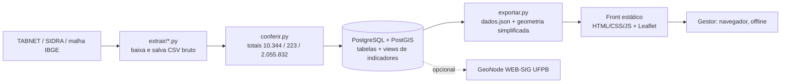

# Plano do WebSIG: arquitetura, front e usabilidade (18/11/2026)

Base: o protótipo anterior do painel (pasta `painel_enxuto/`, fora deste repositório). Regras fixas: só os 5 indicadores (casos, taxa por 100 mil/ano, tipo, faixa etária, observado ÷ esperado); sem nudges; público = gestores; tudo recalculável numa planilha e explicável pela aluna.

## 1. Arquitetura



Decisões:
1. **Front estático, sem servidor de aplicação.** Abre com duplo clique, funciona offline, hospeda grátis (GitHub Pages ou servidor da UFPB). Uma API (FastAPI) só se surgir necessidade de dados em tempo real; hoje não há.
2. **O cálculo mora em um lugar só: views SQL.** `vw_indicador_municipio_ano_tipo` (casos, pop, taxa, esperado, O/E) e `vw_indicador_estado`. O front recebe os casos e a população e repete as mesmas fórmulas para somar períodos; um teste compara front × SQL para todos os 223 municípios.
3. **Dados brutos versionados.** Cada CSV do TABNET guardado com data de acesso; o pipeline inteiro roda de novo com um comando (`atualizar.bat`).
4. **Três conferências que param o processo** se um total não bater: extração, carga, exportação.
5. **Front sem framework** (JS puro em módulos): poucas linhas, nada para compilar, fácil de explicar na banca.

Estrutura do repositório:
```
websig/
  dados/brutos/        CSVs do TABNET e IBGE (com data de acesso)
  pipeline/            extrair.py, conferir.py, exportar.py
  sql/                 01_schema, 02_carga, 03_views_indicadores
  web/                 index.html, css/, js/ (mapa, analise, calculo, dados, util), dados.json, vendor/leaflet
  testes/              testar_dados.py (totais), testar_front.py (Playwright: telas, cálculos, console)
  atualizar.bat        roda tudo em ordem
  README.md
```

## 2. Front

Telas (abas no topo, com endereço próprio: `#mapa`, `#analise`, `#como-calcular`, e `#mapa-2513406` abre um município, para mandar o link a alguém):

**Mapa**
- Esquerda: filtros (indicador, tipo, período), busca com sugestão e sem acento, ranking dos 10 maiores e 10 menores.
- Centro: mapa coroplético. Cores sequenciais (casos, taxa) e divergentes (O/E, centro = "perto da média do estado"). Nenhum município sem cor.
- Direita (ao clicar): ficha do município: 5 indicadores comparados com o estado, série anual, tipos, faixa etária, aviso se < 10 casos. Botão **Imprimir ficha** (o gestor leva para reunião).
- Legenda fixa com a média do estado; tooltip pequeno com nome + valor.
- **Comparar municípios:** escolher 2 ou 3 e ver lado a lado.
- Visão em **tabela** do mesmo mapa (acessibilidade e quem prefere números).

**Análise**
- Números-resumo do estado; leituras prontas (achado → número → pergunta de política); gráficos: casos por ano por tipo, tipos, faixa etária; tabela ordenável com **Baixar CSV**.
- Filtro por **região de saúde** (16 regiões / 3 macrorregiões da PB) para o gestor ver só a sua área e comparar com a média da região. **Depende de obter a lista oficial município → região de saúde da SES-PB [VERIFICAR fonte].**

**Como calcular**
- Para cada indicador: o que é, fórmula, exemplo com números reais, para que serve, cuidado. Link "como calcular" ao lado de cada indicador no mapa e na ficha.
- Fontes, data de acesso e limitações.

## 3. Usabilidade

Personas e tarefas (servem de roteiro para o teste):

| Persona | Pergunta típica | Tarefa de teste |
|---|---|---|
| Gestora estadual (SES-PB) | Onde a notificação está muito abaixo da média? | T1: achar os 3 municípios de menor O/E com pelo menos 10 casos |
| Gestora municipal | Como meu município está em relação ao estado? | T2: abrir a ficha de Sousa e dizer se está acima ou abaixo da média |
| Técnico da vigilância | Que público e que tipo de violência priorizar? | T3: dizer a faixa etária mais atingida em Campina Grande; T4: dizer se a violência sexual cresceu de 2019 a 2024 |
| Todos | Levar os dados para uma reunião | T5: baixar a tabela ou imprimir a ficha |

Princípios (heurísticas de Nielsen):
- Linguagem do gestor, sem jargão; unidade em todo número ("por 100 mil mulheres por ano").
- Toda cor explicada na legenda, com a média do estado como referência.
- Estado visível: filtros ativos escritos no título do mapa ("Taxa · Sexual · 2024").
- Prevenção de erro de leitura: aviso de poucos casos; aviso fixo "notificação ≠ ocorrência"; tipos não somam o total.
- Reconhecer em vez de lembrar: busca com sugestão, ranking clicável, link compartilhável.
- Acessibilidade: contraste AA, teclado em todos os controles, foco visível, paleta segura para daltonismo, tabela como alternativa ao mapa, funciona no celular.

Avaliação (antes da defesa, se o orientador concordar):
- 5 participantes do público-alvo (gestores ou técnicos), sessão de 20 min, remota ou presencial.
- Tarefas T1–T5 com "pensar em voz alta"; medir acerto, tempo e dificuldades.
- Questionário SUS (System Usability Scale) no final + 2 perguntas abertas ("o que faltou?", "usaria no trabalho?").
- Confirmar com o orientador se precisa de Comitê de Ética e como registrar o consentimento.

## 4. Cronograma

| Até | Entrega |
|---|---|
| 25/11 | Pipeline reorganizado, views SQL dos indicadores, exportar.py, testes de dados e front × SQL |
| 02/12 | Front: URLs por tela/município, ficha imprimível, comparar municípios, tabela do mapa, baixar CSV, título com filtros ativos |
| 05/12 | Região de saúde (se a lista oficial for obtida) |
| 09/12 | Teste com usuários + ajustes; capturas finais; repositório público |
